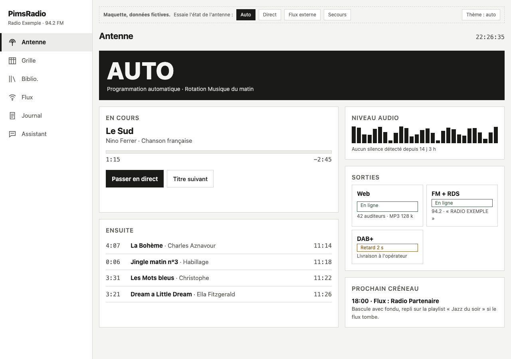
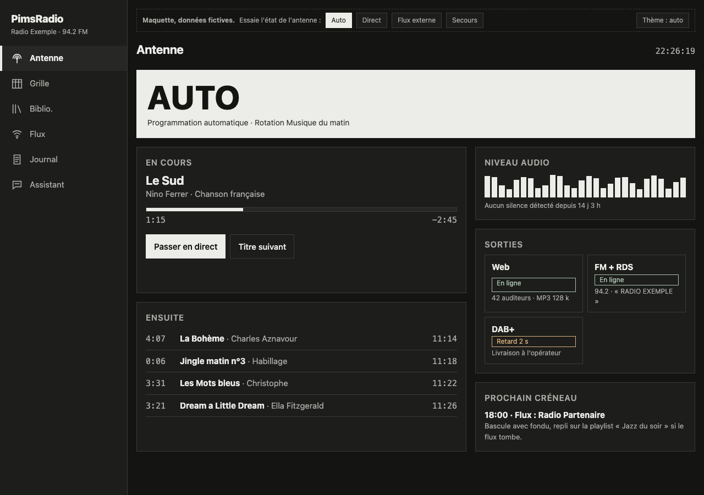
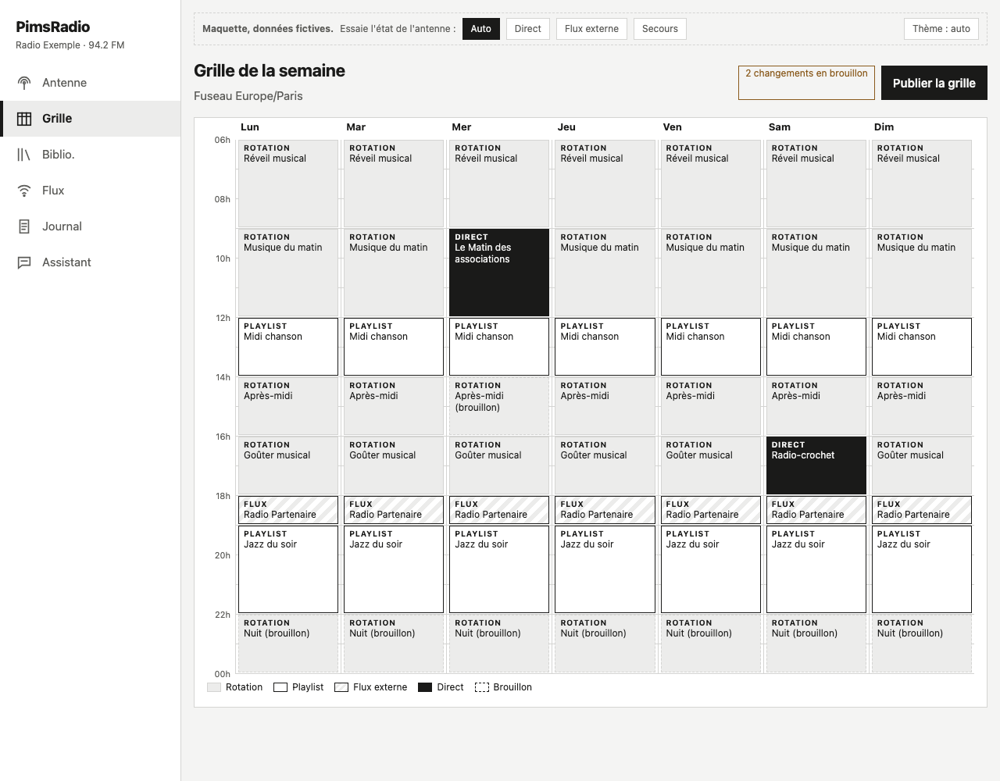
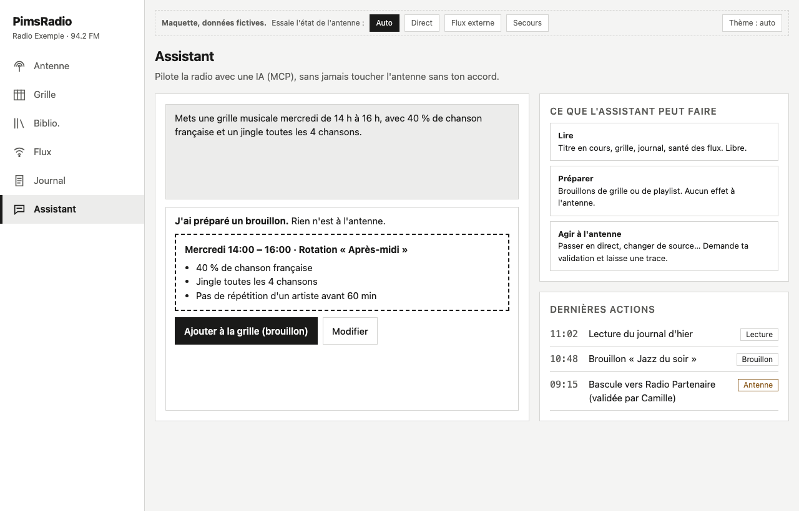
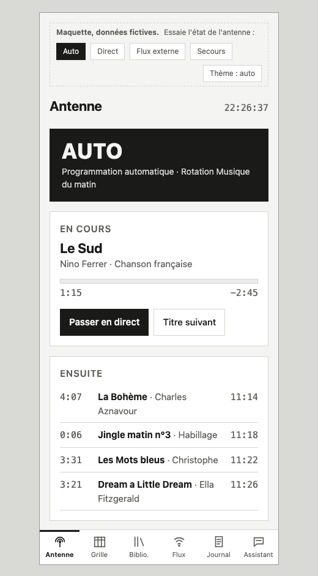

# PimsRadio

**EN** — Open-source automation for community radio stations: FM, DAB+ and web, with a weekly programme grid, external streams, and an **MCP** server so an AI assistant can help run the station.
**FR** — Automation libre pour les **radios associatives** : FM, DAB+ et web, avec une grille de programmes, des flux externes et un serveur **MCP** pour piloter la radio avec un assistant IA.

> **Status / État : early development / développement initial.** Not installable yet / pas encore installable. Plan: [docs/PLAN.md](docs/PLAN.md) (FR) · [docs/en/OVERVIEW.md](docs/en/OVERVIEW.md) (EN) · Decisions: [docs/decisions](docs/decisions/).

## Aperçu / Preview

> **Maquette de conception, pas encore l'outil réel / Design mockup, not the real tool yet.** L'interface n'est pas encore développée : ces images montrent la direction visuelle visée (données fictives). Elles seront remplacées par de vraies captures dès que les écrans existeront. / The interface is not built yet: these images show the intended look (fictional data) and will be replaced by real screenshots once the screens exist.

| Antenne (clair) | Antenne (sombre) |
|---|---|
|  |  |

| Grille de la semaine | Assistant (MCP) | Mobile |
|---|---|---|
|  |  |  |

La maquette interactive source est dans [docs/design/maquette.html](docs/design/maquette.html) (ouvre-la dans un navigateur). / The interactive source mockup is in [docs/design/maquette.html](docs/design/maquette.html) (open it in a browser).

## Goals / Objectifs
- **Never go silent / ne jamais se taire**: audio keeps playing even if the interface crashes / l'audio continue même si l'interface plante.
- **One-command install** and a browser setup wizard for non-technical volunteers / installation en une commande et assistant dans le navigateur.
- One programme to **FM, DAB+ and web** / un même programme vers FM, DAB+ et web.
- **External streams** schedulable in the grid, with automatic fallback / flux externes programmables, avec bascule de secours.
- **MCP**: free reading, harmless drafts, on-air actions need human approval / lecture libre, brouillons sans effet, antenne avec validation humaine.

## Tech / Technique
Node.js + TypeScript (control plane / plan de contrôle), Liquidsoap + Icecast (audio), SQLite. License / licence: **AGPL-3.0**.

## Develop / Développer
```bash
npm install
npm test          # build + 22 tests
npm run gen-engine  # generates the Liquidsoap script (engine/generated/radio.liq)
```
The audio engine needs Docker (see `deploy/docker-compose.dev.yml`, draft). / Le moteur audio demande Docker (brouillon).
